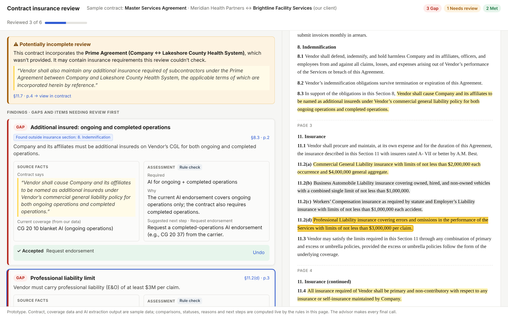

# Case 1: Contract insurance review

Finds every insurance requirement in a contract, proves each one with an exact quote, compares it to the client's coverage with rules, and leaves the decision to the advisor. Overview and results: [top-level README](../README.md#1-contract-insurance-review).

| Folder | Contents |
|---|---|
| `app/index.html` | The prototype (open in a browser, click **use saved sample**) |
| `eval/` | Blind contract B, answer keys v1 and v2 with `FROZEN.sha256`, the raw live run and its score, `score.py` |
| `tests/` | `e2e.py` (click-through checks), `messy.py` (malformed model output) |
| `docs/` | Opener slides, demo guide, result PDFs, screenshots |

