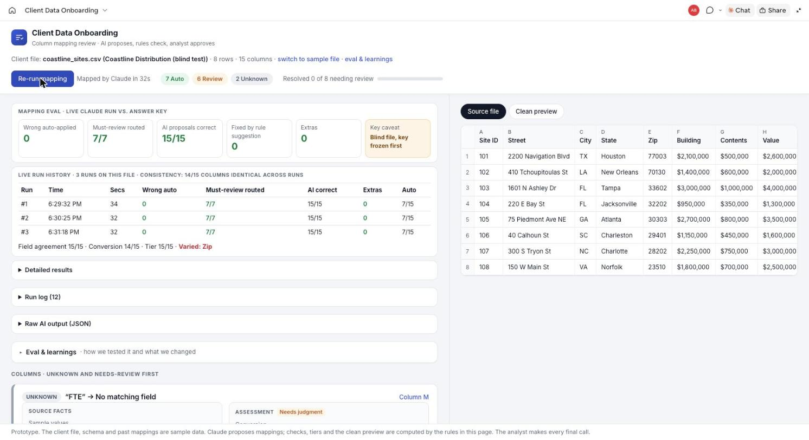

# Case 2: Client data onboarding

Maps a client's spreadsheet columns to internal fields. The model proposes; value checks decide whether a mapping is applied automatically, reviewed, or left unknown. Overview and results: [top-level README](../README.md#2-client-data-onboarding).

| Folder | Contents |
|---|---|
| `app/` | The prototype (`index.html`), with its source (`app.js`, `body.html`, `base_style.css`) |
| `blind/` | Blind file and answer key with `FROZEN.sha256` |
| `tests/` | `test.py` (click-through checks), `adversarial.py` (14 malformed-output cases) |
| `docs/` | Opener slides, demo guide, claims table, blind results, class-code fix, screenshots |

