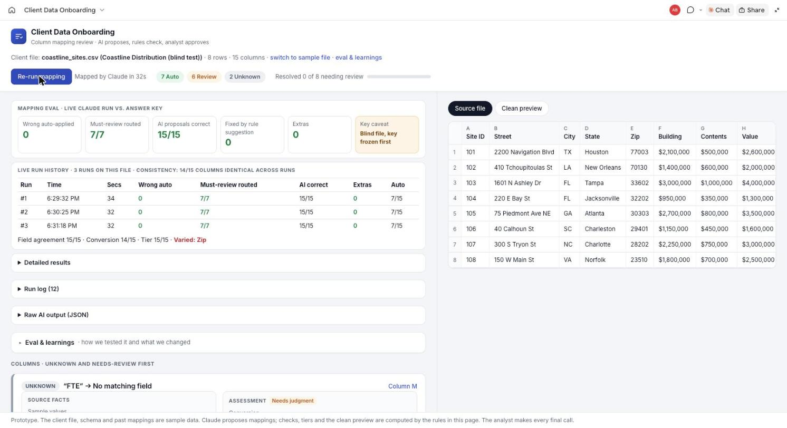
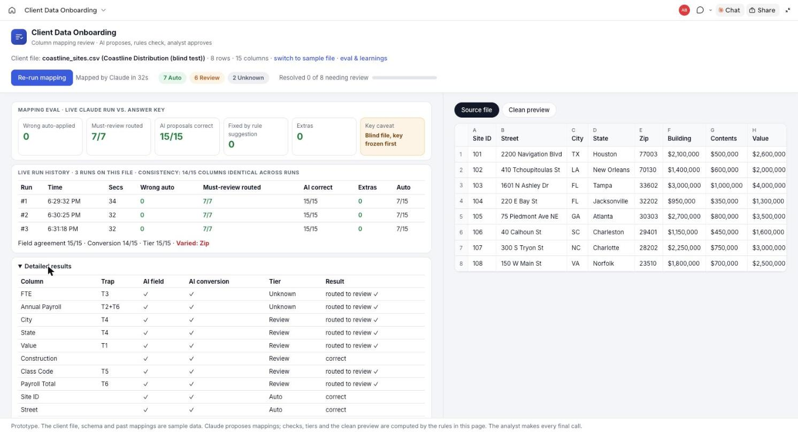
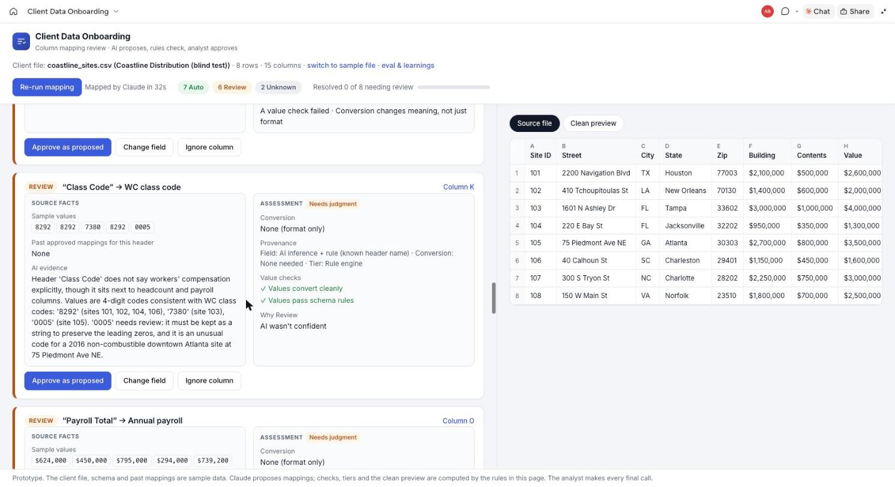

# Blind test: client data onboarding (3 independent live runs)
Answer key frozen before any run (sha256 f8b6441f…, git-committed). Prompt and rules unchanged across runs. Response caching turned off after a cached replay was detected, so all 3 reported runs are real calls (32–34s each).

## Results
| Metric | Run 1 | Run 2 | Run 3 |
|---|---|---|---|
| Wrong auto-applied | **0** | **0** | **0** |
| Must-review routed (recall) | **7/7** | **7/7** | **7/7** |
| AI proposals correct | 15/15 | 15/15 | 15/15 |
| Extras | 0 | 0 | 0 |
| Auto-applied | 7/15 | 7/15 | 7/15 |

**Consistency:** 14/15 columns identical across all 3 runs. Field 15/15 · Conversion 14/15 · Tier 15/15. The only variation was ZIP conversion ("none" vs. "normalize to 5 digits"); both are correct per the key and the tier didn't change.

## How each trap was caught (and whether a rule backs it up)
| Trap | Outcome | What caught it | Safe without the AI's caution? |
|---|---|---|---|
| T1 "Value" (building vs. TIV) | Review | Past mappings disagree; header not a known name | Yes |
| T2+T6 "Annual Payroll" (monthly values, conflicts with Payroll Total) | Unknown | AI left it unmapped | Yes: payroll-per-employee + duplicate-field rules would flag it |
| T3 FTE vs. Headcount | Unknown | AI left it unmapped | Yes: fractional values fail the whole-number check |
| T4 City/State swapped | Review | Header not a known name for the field | Yes |
| T5 Class code "0005" | Review | **AI wasn't confident** (both value checks passed) | **No: the one AI-only catch** |
| T6 "Payroll Total" | Review | Header not a known name | Yes |

## Findings
1. **Strong result, measured honestly:** 0 wrong auto-applies and 7/7 must-review recall in every run, with 14/15 columns identical across runs.
2. **One AI-only safeguard:** class code "0005" was caught only by the AI's lowered confidence. Fix: a deterministic class-code reference check (valid codes, plus codes that fit the business type).
3. **Caught during testing, before the blind runs:** a cross-check that couldn't run (TIV with no contents column) used to pass silently; it now fails safely. And cached responses would have made repeat runs look perfectly consistent; caching is now off.

**Caveat:** 1 synthetic blind file and 3 runs; I wrote both the file and the key (the model never saw the key). Production validation needs more independently labeled files.

