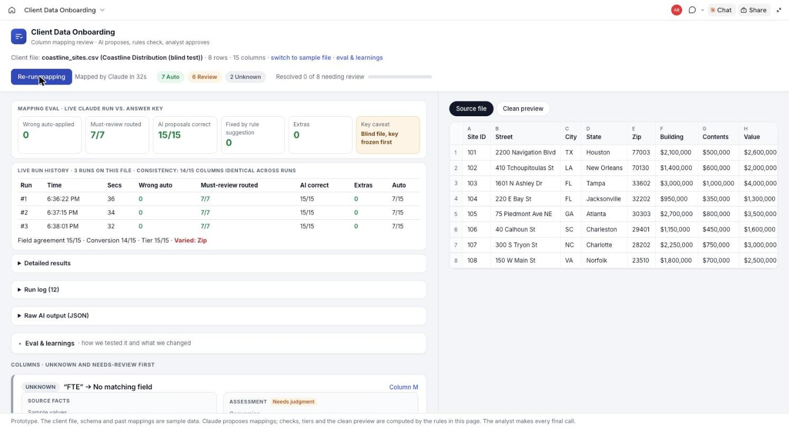
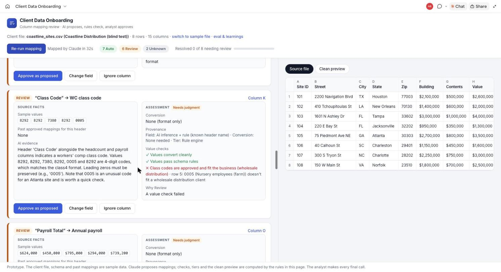

# Fix: deterministic class-code check (blind file replay + 3 live runs)
Only change: a class-code reference check (approved code list + business-type fit). Prompt, other rules, answer key and UI behavior unchanged. Frozen blind file and key verified intact (checksums OK).

## What the check does
- Codes compared as exact text, so leading zeros are preserved ("0005" stays "0005").
- Not in the approved set → Review. In the set but doesn't fit the client's business type → Review. Malformed → Review.
- Doesn't read AI confidence at all.

## Forced-high replay (every AI confidence set to "high")
| | Class Code | Wrong auto-applied | Must-review recall |
|---|---|---|---|
| Before fix | **Auto** (gap confirmed) | 1 | 6/7 |
| After fix | **Review**: "0005 (Nursery employees (farm)) doesn't fit a wholesale distribution client" | **0** | **7/7** |

Extra path tests: 9999 → not in approved set → Review; 5183 (plumbing) → doesn't fit the business → Review; 08810 → malformed → Review.

## 3 independent live runs after the fix
| Metric | Run 1 | Run 2 | Run 3 |
|---|---|---|---|
| Wrong auto-applied | 0 | 0 | 0 |
| Must-review routed | 7/7 | 7/7 | 7/7 |
| AI proposals correct | 15/15 | 15/15 | 15/15 |
| Extras | 0 | 0 | 0 |
| Seconds | 36 | 34 | 32 |

Consistency 14/15 (only ZIP conversion varied; both acceptable). In this run Claude rated Class Code **high** confidence, and the rule alone still routed it to Review.

## Regressions
None: sample-file test, 14 malformed-output cases and 5 messy-value cases all pass; sample "Class" column still auto-applies (8810/7380/8292 are approved and fit distribution).

**Now 6 of 6 blind traps are caught by deterministic rules, independent of AI confidence.**
Caveat: the reference list is a small prototype sample; production needs the full class-code table and the client's real business classification.

