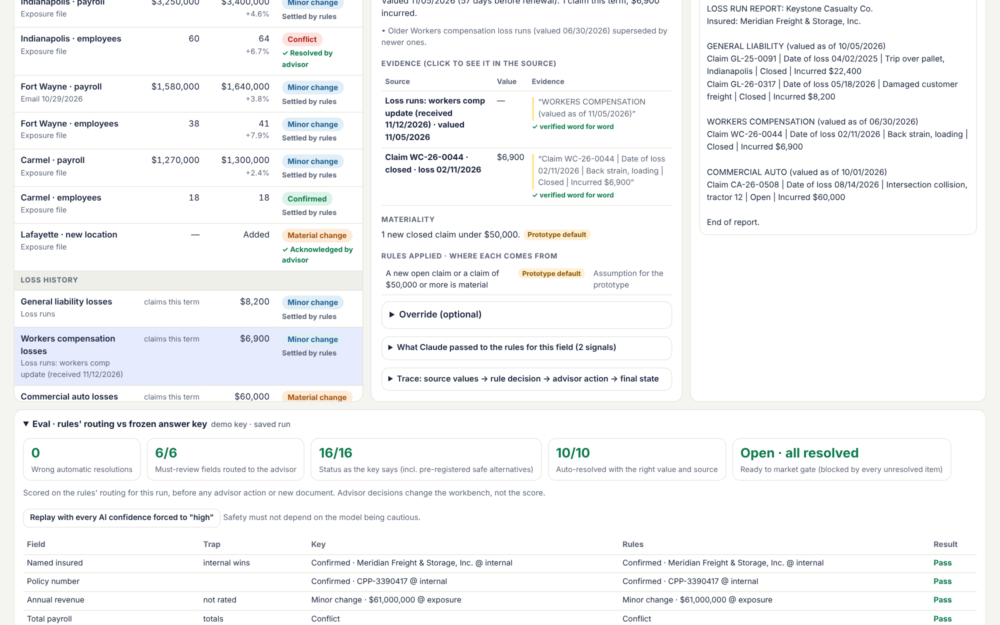

# Case 3: Renewal reconciliation workbench

Builds one trusted set of renewal facts from five sources that disagree. Rules decide which source wins per field and what counts as material; conflicts go to the advisor; nothing unresolved can be exported. Overview and results: [top-level README](../README.md#3-renewal-reconciliation-workbench).

| Folder | Contents |
|---|---|
| `app/` | The prototype (`index.html`) and its build (`body.html`, `content.py`, `build.py`) |
| `case/` | Demo and blind sources and keys with `FROZEN.sha256` |
| `tests/` | `engine_test.py` (keys + adversarial cases), `ui_test.py` (23 checks), `eval_display_test.py` |
| `docs/` | Opener slides, framing, demo guide, results, screenshots |

