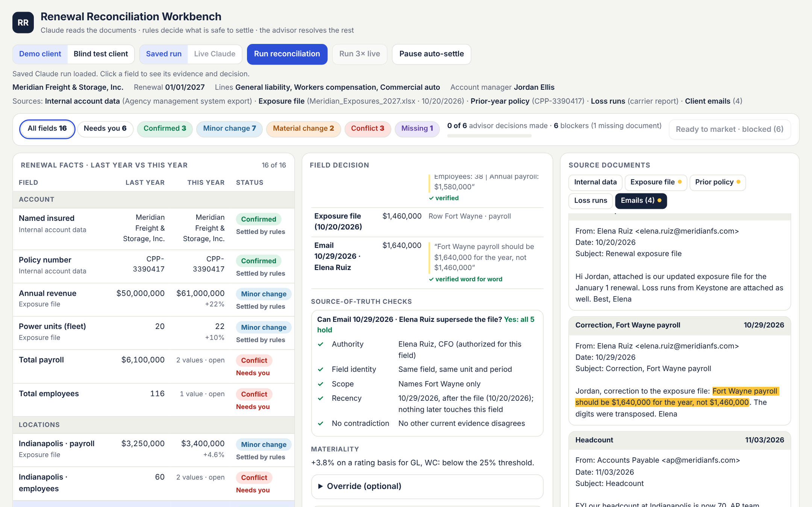
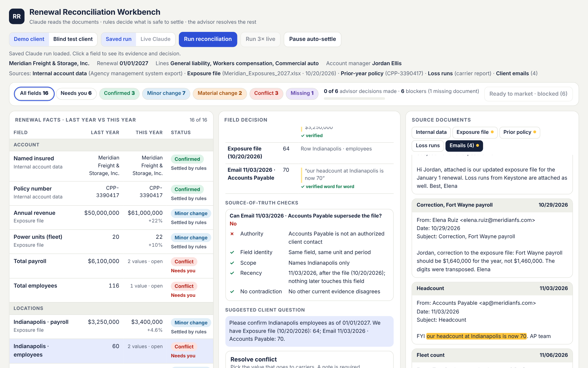
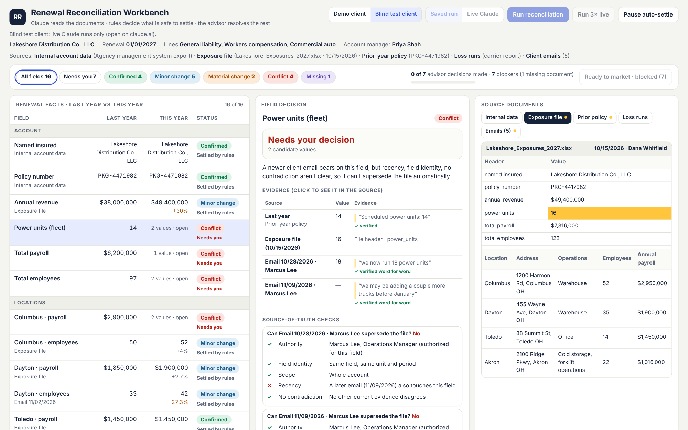
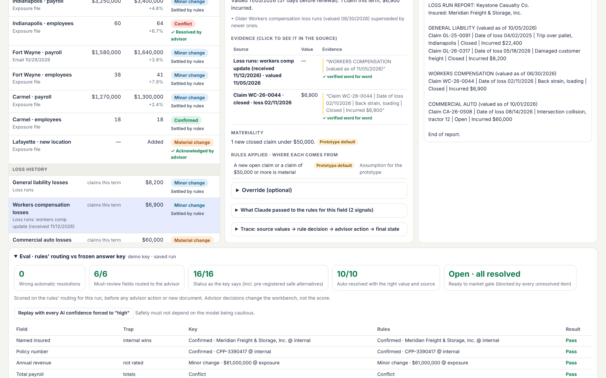

# Mock 3: Renewal Reconciliation Workbench, build status (before live blind runs)

**Exec summary.** Five renewal sources disagree. Claude extracts evidence with exact quotes from the unstructured sources only (prior policy, loss runs, emails); code parses the structured ones (internal account data, exposure spreadsheet). Rules apply source of truth per field, settle only what is provably safe, and route conflicts, material changes and missing items to the advisor. Ready to market is hard-blocked until all are resolved. Kill switch pauses auto-settle; it also stops itself after a bad run.

**Source-of-truth rule.** Internal data wins for policy metadata; latest exposure file wins for current exposures; a client email supersedes only if all 5 hold: authorized sender, same field + unit + period, clear scope (quote names the location), newer than the file with nothing later touching the field, no contradicting evidence.

**Materiality.** Rating basis (payroll for GL/WC, power units for auto) moves 25% or more, or 50%+ of growth from a new location, or any new location = Material. Non-rating fields (revenue, headcount) = Minor. Loss runs older than 120 days = Missing; new open claim or claim of $50k or more = Material.

**Backstops (route only, never settle).** Quote verification; keyword scan of newer emails for unextracted fields; monthly wording check; totals must equal locations and can't be final while a location is open; claim-count check vs the document; malformed output flagged. Confidence ignored.

## Offline results (live blind runs pending)
- Blind answer key: 16 fields, 8 traps, 7 must-review. Frozen with chmod 444 + sha256 98375393ab6e… + git before any code or run.
- Demo client, saved run: 0 wrong automatic resolutions, 6/6 must-review routed, 16/16 statuses.
- Blind client with a perfect (hand-written) extraction: 0 wrong, 7/7 routed, 16/16 statuses (total payroll lands on its pre-registered safe alternative, Conflict, because Columbus payroll is open; the concentration materiality flag is still raised).
- Forced-high and forced-low confidence: identical.
- 15 adversarial AI outputs (fake quote, mis-scoped email, dropped vague email, dropped monthly email, monthly labeled annual, unknown doc, non-numeric value, string booleans, invented WC loss runs, dropped open claim, dropped prior values, duplicates, empty, non-object, vague email over-read as explicit): all 15 give 0 wrong automatic resolutions and 7/7 routing.
- 23/23 end-to-end UI checks: gate blocks, Missing has no override, notes required, undo, totals recompute, document-received flow, export with 16 sourced facts, no console errors.

