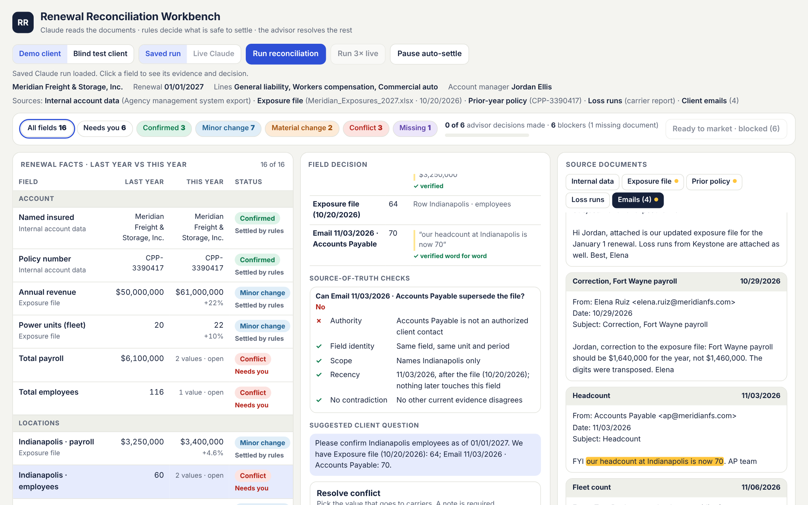
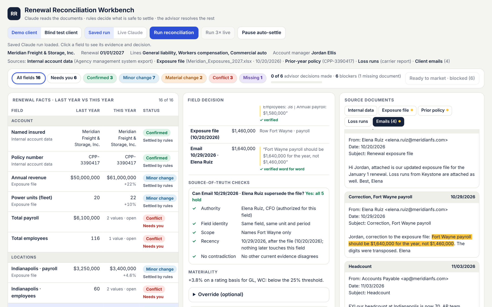

# Mock 3: blind live results + one precision fix (Renewal Reconciliation Workbench)

**Setup.** Blind client Lakeshore Distribution: 16 fields, 8 traps, 7 must-review. Answer key frozen (chmod 444, sha256 98375393ab6e…, git) before any code or run. Extraction prompt and thresholds unchanged since the key was frozen (verified by diff). 3 uncached live runs, raw output stored per run.

**Hardening before the runs (display only, no logic change):**
- Rule provenance on every field and in a register. The 25% rating-basis, 50% new-location growth, 120-day loss-run freshness and $50k claim thresholds (plus new-location, non-rating-field, totals and missing-document rules) are labeled *Prototype default*. Source authority and the email rule are *Advisor-configured (stated in discovery)*. Contacts and rating bases are *Verified system of record*.
- Eval display bug fixed: the scorecard re-scored advisor decisions as rule errors (0 / 6/6 / 16/16 became 2 / 4/6 / 14/16 after the demo flow). It now scores each run's own rule output.

## Results (identical in all 3 runs)
| Metric | Run 1 | Run 2 | Run 3 |
|---|---|---|---|
| Wrong automatic resolutions | 0 | 0 | 0 |
| Must-review routed to advisor | 7/7 | 7/7 | 7/7 |
| Status matches key (incl. pre-registered safe alternative) | 15/16 | 15/16 | 15/16 |
| Auto-resolved with right value and source | 8/8 resolved (8 of 9 key auto fields) | same | same |
| Concentration flagged material (T3) | yes | yes | yes |
| Validation problems | 0 | 0 | 0 |
| Time | 88.8s (first call) | 31.0s | 32.9s |

**Consistency:** 16/16 fields got the same status and value in all 3 runs.

**Traps:** T1 Dayton email applied to Dayton only (42 from the email), total employees flagged (130 vs 123); T2 fleet: explicit 18 blocked by a later vague email; T3 payroll +18% flagged material via new-location concentration (status Conflict, the pre-registered safe alternative, because Columbus is open); T4 revenue +30% minor (not a rating basis); T5 internal policy number wins over the transposed exposure-file value; T6 Akron new location material; T7 Columbus monthly $255,000 vs annual file → conflict; T8 WC loss runs missing → Ready to market blocked.

**The one miss (over-escalation, safe direction), now fixed:** Dayton payroll went to Conflict instead of Minor change. Claude reported email 4's line "their wages are already in the Dayton payroll figure" as a vague (explicit false) payroll statement, and the rule treats any newer email touching the field as blocking. Costs one advisor check; no wrong data. Fix applied after the runs: a vague (non-explicit) email statement blocks an otherwise safe resolution only if its quote or sentence signals a change, using the existing change-word test. Authority, field identity, scope, recency and contradiction checks, the missing-document gate, materiality rules, the prompt and the frozen key are unchanged.

**Replay after the fix:** the 3 stored live outputs now score 0 wrong / 7/7 routed / 16/16 statuses / 9/9 provenance, under as-is, forced-high and forced-low confidence. Demo key 16/16; blind perfect extraction 16/16; all 15 adversarial cases plus 2 new ones aimed at the fix (vague fleet quote trimmed so the change word is only in the sentence; fragment quote of the inert Dayton line) safe; 23/23 UI checks. No regressions.

**Fresh live confirmation on the fixed version (3 more uncached runs):** 0 wrong automatic resolutions, 7/7 routed, 16/16 statuses, 9/9 provenance, 16/16 identical across runs, 0 validation problems, 30.0 / 31.7 / 30.3 s.

**Regressions:** none versus the offline suite (offline perfect extraction 16/16; the live difference is entirely the Dayton line above).

**Prior offline evidence:** 15/15 adversarial AI outputs safe; forced-high/low confidence identical; 23/23 UI checks; demo client 0 / 6/6 / 16/16.

