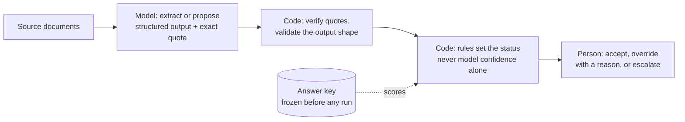
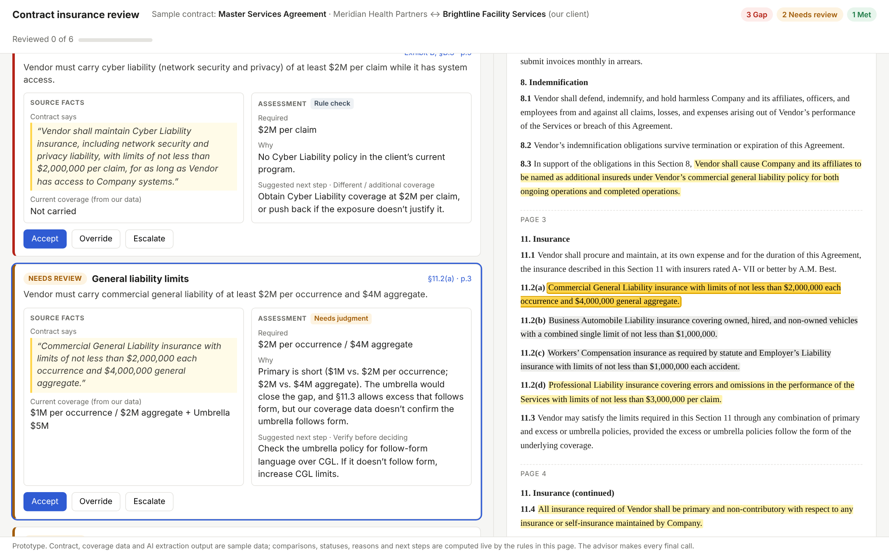
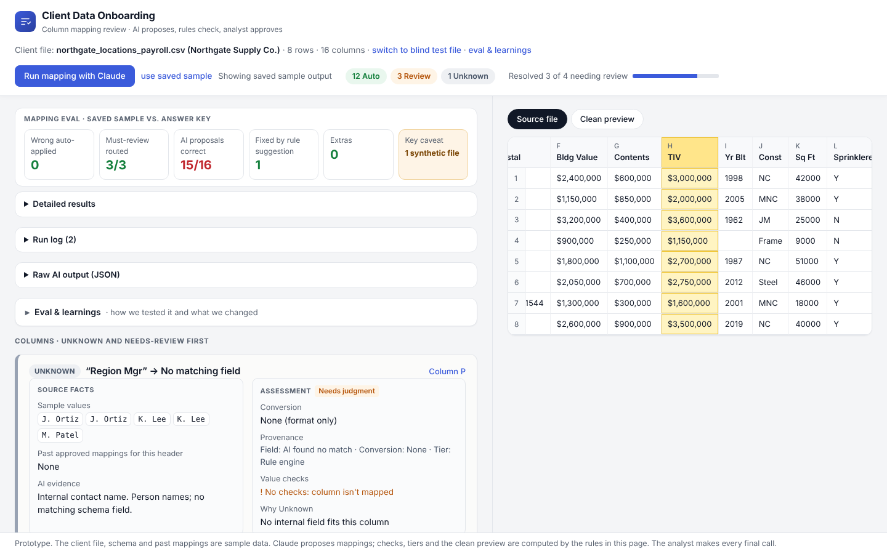
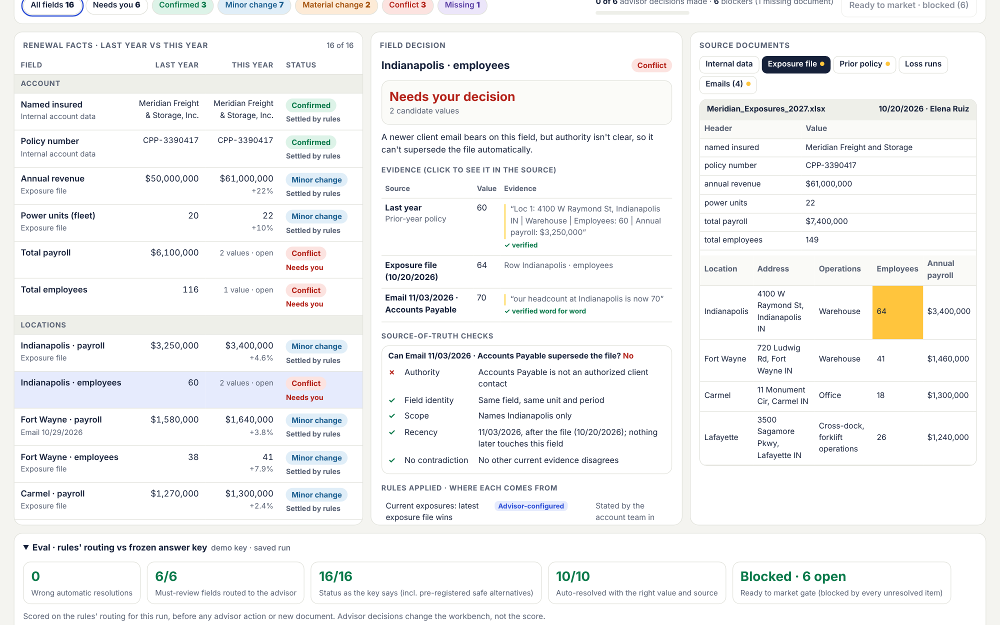

# AI product case prototypes: three human-in-the-loop workflows for commercial insurance

Three working prototypes, each built in about an hour as a product management + AI case exercise. Each one takes a real advisory workflow, puts a model on the reading and proposing, puts plain code on the deciding, and leaves the final call to a person. Each was then scored against an answer key that was frozen before the model ever ran.

They are the lead-up to a fourth, larger build: **[service-request-agents](https://github.com/arnavbansal1/service-request-agents)**, a multi-agent system with an orchestrator, a workflow engine, an LLM judge and a trace viewer. Read that one first if you only read one. This repo shows where its method came from.

> **Scope of the evidence.** Everything here is development evidence on synthetic data. Each blind test is one synthetic case that I wrote, with a key the model never saw. Nothing here is validated on real client documents.

## The three cases at a glance

| # | Case | Who it helps | What the model does | What code decides | Blind result (frozen key) |
|---|---|---|---|---|---|
| 1 | [Contract insurance review](01-contract-insurance-review/) | Advisor reviewing a client's contract | Finds every insurance requirement, with the exact quote | Verifies each quote word for word, compares to coverage, sets Met / Gap / Needs review | 11/11 requirements found, 0 missed, 1 low-harm extra, 4/4 statuses correct (1 run) |
| 2 | [Client data onboarding](02-client-data-onboarding/) | Analyst loading a client's spreadsheet | Proposes a field and conversion for each column | Value checks set the tier: Auto / Review / Unknown | 0 wrong auto-applied, 7/7 must-review routed, 15/15 proposals correct (3 runs) |
| 3 | [Renewal reconciliation](03-renewal-reconciliation/) | Account manager preparing a renewal | Pulls each fact from 5 sources, with a quote | Source-of-truth and materiality rules pick a value or raise a conflict; a gate blocks "ready to market" | 0 wrong automatic resolutions, 7/7 routed, 16/16 statuses after one narrow fix (3 fresh runs) |

## The pattern all three share



1. **The model reads; rules decide.** The model's output is a typed proposal. Status comes from code that can be tested without a model.
2. **No proof, no pass.** Every finding carries a quote that is checked word for word against the source. Unverified means "Needs review".
3. **Safety cannot depend on model confidence.** Each prototype is replayed with every confidence forced to "high". The safe outcome has to hold anyway.
4. **The answer key is frozen first.** Written before any run, checksummed (`FROZEN.sha256`) and committed, never shown to the model. A revision is a new version file, frozen again.
5. **The blind test is there to find our bugs.** In all three cases it did, and the fix is documented next to the result.

## 1. Contract insurance review

**Problem.** Advisors don't struggle with the insurance decision. They struggle to find every requirement in a long contract, including the ones outside the insurance section.

**Product.** A cited checklist. Findings on the left, the contract on the right, and one click from a card to the exact sentence. The advisor accepts, overrides with a reason, or escalates.



**Blind test.** A harder synthetic subcontract with seven traps: a requirement in the indemnity section, two clauses that conflict with a "more stringent governs" rule, an ambiguous additional-insured clause, a referenced manual that wasn't provided, and a "recommended, not required" sentence.

| Measure | Result |
|---|---|
| Requirements found | 11/11 (in scope 4/4, out of scope surfaced 6/6, external reference 1/1) |
| Missed | 0 |
| Extras | 1: the "recommended, not required" sentence was listed, though labeled as not required |
| Quotes verified word for word | All |
| Status correct | 4/4 |

**What the test found in our own rules.** An additional-insured clause with no stated scope would have computed as "Met". Only the model's lowered confidence stopped it. The rule now treats unspecified scope as "Needs review" on its own, and conflicting clauses for one requirement show as one card. Both fixes were replayed with confidence forced high.

Evidence: [results (PDF)](01-contract-insurance-review/docs/Blind_Eval_Contract_B_Results.pdf) · [contract and frozen key (PDF)](01-contract-insurance-review/docs/Blind_Eval_Contract_B_and_Frozen_Answer_Key.pdf) · [raw run and score](01-contract-insurance-review/eval/runs/)

## 2. Client data onboarding

**Problem.** Every client sends locations and payroll in a different spreadsheet layout. A column mapped to the wrong field, or monthly payroll read as annual, flows silently into pricing.

**Product.** The model proposes a field and a conversion per column. Value checks decide whether that proposal is applied automatically, sent to review, or left unknown. A clean preview shows the result before anything is loaded.



**Blind test.** One synthetic file, 15 columns, six traps: "Value" (building or total insured value?), monthly numbers under an "Annual Payroll" header, full-time equivalents presented as headcount, swapped city and state, a class code that is valid but wrong for the business, and two columns competing for one field.

| Measure | Run 1 | Run 2 | Run 3 |
|---|---|---|---|
| Wrong auto-applied | 0 | 0 | 0 |
| Must-review routed | 7/7 | 7/7 | 7/7 |
| Proposals correct | 15/15 | 15/15 | 15/15 |

Consistency: 14 of 15 columns identical across runs. The one difference was a ZIP formatting choice; both versions match the key.

**What the test found.** Five of six traps were caught by rules. The sixth, class code "0005", was caught only because the model wasn't confident. With confidence forced high it was auto-applied. Fix: a deterministic class-code check (approved list, plus fit with the client's business type). After the fix all six traps are caught by rules, confirmed on 3 more live runs, one of which rated the class code "high" and was still routed to review.

Also caught along the way: cached responses made repeat runs look perfectly consistent, so caching was turned off before the reported runs.

Evidence: [blind results](02-client-data-onboarding/docs/blind_results.md) · [class-code fix](02-client-data-onboarding/docs/classcode_fix.md) · [claims table](02-client-data-onboarding/docs/CLAIMS.md)

## 3. Renewal reconciliation workbench

**Problem.** At renewal, the client picture is rebuilt by hand from last year's policy, internal data, a new exposure file, loss runs and client emails. The sources disagree, and a mistake here is copied to every carrier.

**Product.** One table of renewal facts, last year against this year. For each field, rules decide which source wins and whether the change is material. An email overrides the file only if it passes five checks (authority, field identity, scope, recency, no contradiction). Anything unresolved blocks "ready to market".



**Blind test.** A second synthetic client: 16 fields, 8 traps, 7 fields that must reach the advisor.

| Measure | 3 live runs before the fix | 3 fresh live runs after |
|---|---|---|
| Wrong automatic resolutions | 0 | 0 |
| Must-review routed | 7/7 | 7/7 |
| Status matches key | 15/16 | 16/16 |
| Same result across runs | 16/16 fields | 16/16 fields |

**What the test found.** One over-escalation, in the safe direction: a passing remark in an email ("their wages are already in the Dayton payroll figure") blocked a resolution that was fine. The fix was narrow: a vague email statement blocks only if its sentence signals a change. Two new adversarial cases target the fix. A scorecard bug was also found and fixed: it had been re-scoring the advisor's own decisions as rule errors.

Evidence: [results and fix](03-renewal-reconciliation/docs/handoff_results.md) · [framing](03-renewal-reconciliation/docs/M3_Framing.md) · [results (PDF)](03-renewal-reconciliation/docs/M3_Blind_Results.pdf)

## What changed from case to case

| Case | Added to the method |
|---|---|
| 1 | Quote verification, three statuses, frozen key, forced-high-confidence replay |
| 2 | Three independent live runs with a consistency count, a claims table (only say what has evidence), caching turned off |
| 3 | Rule provenance on every decision, a pre-registered "safe alternative" in the key, engine tests separate from UI tests, a hard gate before export |
| 4 ([service-request-agents](https://github.com/arnavbansal1/service-request-agents)) | Several agents with narrow permissions, a workflow engine in code, an LLM judge, traces, an outage drill |

## What is real, what is mocked, what is not built

- **Real:** the live model calls behind every reported run, quote verification, all rules, the scoring against frozen keys, the test suites in this repo.
- **Mocked:** every contract, spreadsheet, policy, email and coverage record is synthetic. Carrier forms and system-of-record integrations are stubs.
- **Not built:** sign-in, storage, real document parsing (PDF, scans), monitoring. Reference lists and thresholds are small prototype defaults.

## Run it

Each app is one self-contained `index.html`. Open it in a browser and click **use saved sample** (the live "Run with Claude" button needs the hosted environment the apps were built in).

```bash
pip install playwright        # tests drive Chrome through Playwright
python3 01-contract-insurance-review/tests/e2e.py
python3 02-client-data-onboarding/tests/test.py
python3 02-client-data-onboarding/tests/adversarial.py
python3 03-renewal-reconciliation/tests/engine_test.py
python3 03-renewal-reconciliation/tests/ui_test.py
```

The test scripts expect Chrome at `/usr/bin/google-chrome`; change `executable_path` if yours is elsewhere.

## Repo map

```
01-contract-insurance-review/   app/  eval/ (contract, frozen keys, run + score)  tests/  docs/
02-client-data-onboarding/      app/  blind/ (file, frozen key)                   tests/  docs/
03-renewal-reconciliation/      app/  case/ (sources, frozen keys)                tests/  docs/
```

Each `docs/` folder holds the opener slides, the demo guide used to present the prototype, and the result write-ups.
